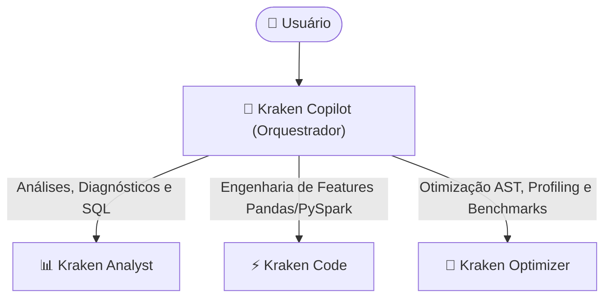

# 🐙 Kraken Copilot

O **Kraken Copilot** é um copiloto autônomo de **Análise de Dados e Engenharia de Pipelines**, inspirado na experiência do **Databricks Genie**.

Ele permite que cientistas, engenheiros e analistas interajam em linguagem natural para explorar bases de dados, responder perguntas de negócio com consultas SQL reais, investigar insights e criar, refatorar ou otimizar pipelines de dados e *Feature Engineering* diretamente no projeto — validando a execução do código de ponta a ponta.

---

## 🏗️ Arquitetura

O produto opera em uma arquitetura multi-agentes composta pelo **Orquestrador Central (Kraken Copilot)** e **3 Especialistas Técnicos**:



- **Kraken Copilot (`kraken_copilot`)**: Orquestrador principal. Interpreta a intenção do usuário em linguagem natural e coordena os especialistas técnicos com transferências nativas via Google ADK.
- **Kraken Analyst (`kraken_analyst`)**: Explora os datasets em `pipeline/dados/`, gera diagnósticos de qualidade, estatística descritiva, consulta o Dicionário de Dados e executa queries SQL analíticas em memória (`analyze_dataset`, `query_dataset`, `search_knowledge_base`).
- **Kraken Code (`kraken_code`)**: Projeta pipelines completos e adiciona novas features para Machine Learning agnósticas a qualquer dataset, suportando nativamente Pandas e PySpark (`generate_feature_pipeline`, `add_feature_to_pipeline`, `preview_features`).
- **Kraken Optimizer (`kraken_optimizer`)**: Realiza diagnóstico estático AST, propõe e aplica otimizações sob autorização explícita, gera backups automáticos e executa benchmarks comparativos de Antes vs Depois em tempo e memória (`inspect_pipeline`, `optimize_pipeline`, `validate_pipeline`).

---

## 🛠️ Tecnologias

- **Python**
- **Google ADK** (Orquestração Multi-Agentes e Interface Web)
- **LiteLLM** (Conector agnóstico de modelos: Ollama, Gemini, OpenAI, etc.)
- **ChromaDB** (RAG para documentação e regras de negócio)
- **Pandas, PySpark & Scikit-Learn** (Processamento de dados e *Feature Engineering*)
- **SQLite** (Motor analítico SQL em memória)

---

## 📋 Pré-requisitos

- **Git**
- **Python 3.13+** (via Conda, `venv` ou `uv`)
- **Provedor de LLM** (escolha um):
  - **Local**: [Ollama](https://ollama.com/) instalado e em execução.
  - **Nuvem**: Chave de API (ex: Google AI Studio / Gemini, OpenAI, Anthropic).

---

## 🚀 Como Executar

### 1. Prepare o Modelo (Caso use Ollama Local)
Se for utilizar um modelo local, inicie o servidor do Ollama e baixe o modelo desejado:
```bash
ollama serve
ollama pull qwen3.6:35b-a3b  # ou qwen2.5:14b
```

### 2. Configure o arquivo `.env`
Crie o seu arquivo `.env` a partir do exemplo do projeto:
```bash
cp .env.example .env
```

Edite o `.env` conforme o modelo que deseja utilizar:

- **Para usar Ollama (Local):**
  ```env
  LLM_MODEL=ollama_chat/qwen3.6:35b-a3b
  LLM_API_KEY=ollama
  LLM_API_BASE=http://localhost:11434
  ```

- **Para usar Google Cloud Vertex AI (Recomendado / Nuvem):**
  ```env
  GOOGLE_CLOUD_PROJECT=spartan-setting-485114-e3
  GOOGLE_CLOUD_LOCATION=global
  GOOGLE_GENAI_USE_VERTEXAI=True
  LLM_MODEL=gemini-2.5-flash
  LLM_API_KEY=
  LLM_API_BASE=
  ```
  *(Veja a seção abaixo para autenticar o ADC com `gcloud`).*

- **Para usar Google Gemini (Google AI Studio / API Key):**
  ```env
  GOOGLE_GENAI_USE_VERTEXAI=False
  LLM_MODEL=gemini/gemini-2.5-flash
  LLM_API_KEY=SUA_API_KEY_AQUI
  GEMINI_API_KEY=SUA_API_KEY_AQUI
  LLM_API_BASE=
  ```

### 3. Autenticação no Google Cloud / Vertex AI (Application Default Credentials - ADC)

Caso utilize o **Google Cloud Vertex AI** (Opção 1), as bibliotecas Python necessitam das credenciais locais do ADC. Execute no seu terminal (WSL):

```bash
# 1. Ative seu ambiente python (se aplicável)
conda activate kraken-copilot  # ou seu ambiente configurado

# 2. Autentique as credenciais padrão de aplicação (ADC)
gcloud auth application-default login

# 3. Defina o projeto de cota do Google Cloud
gcloud auth application-default set-quota-project spartan-setting-485114-e3
```

> [!NOTE]
> O comando `gcloud auth application-default login` abrirá seu navegador para você conceder acesso à sua conta Google vinculada ao projeto. O arquivo de credenciais será gerado automaticamente em `~/.config/gcloud/application_default_credentials.json`. Se suas credenciais expirarem no futuro, basta reexecutar esses comandos.

### 4. Instale as dependências
Com **uv**:
```bash
uv sync --active
```

Ou com **pip** / **conda**:
```bash
pip install -r requirements.txt
```

### 5. Inicie a Interface Web do Kraken Copilot

Você pode utilizar a **Interface Web Própria do Kraken Copilot** (recomendada para a melhor experiência) ou o ADK Web genérico:

#### Opção A: Interface Própria do Kraken Copilot (Recomendado)
Inicie o servidor web dedicado do Kraken Copilot:
```bash
python -m kraken_copilot.server
```
Abra no navegador em **`http://localhost:8080`**:
- **Chat com Especialistas**: Identificação visual automática de qual especialista respondeu (`📊 Kraken Analyst`, `⚡ Kraken Code` ou `🚀 Kraken Optimizer`).
- **Cards de 1 Clique**: Ações rápidas para análise de datasets, resumos estatísticos, criação de features e otimização de pipeline.
- **Formatação Rica**: Renderização limpa de tabelas analíticas Markdown, queries SQL e blocos de código com botão de cópia.
- **Página de Investigação e Observabilidade**: Acesse `/investigar/{execucao_id}` para auditar a timeline completa da execução, guardrails acionados, latência e métricas de telemetria.

#### Opção B: Google ADK Web (Genérico)
Caso deseje utilizar o visualizador padrão do Google ADK:
```bash
adk web .
```
Acesse em **`http://localhost:8000`**.

---

## 🧪 Testes

Para rodar a suíte de testes automatizados:
```bash
pytest tests -v
```

---

## 👥 Autores

- **Matheus Santos** — `matheus.h.s.santos@hotmail.com`
- **Andre Yai** — `yai.andre@gmail.com`
- **Leo Takahara** — `takahara.leo@gmail.com`
- **Vinicius Alencar** — `viniciusalencaroliveira@gmail.com`
- **Hugo Martins** — `hmartins19@gmail.com`
- **Tiago Alvarenga** — `tiago.aalvarenga@gmail.com`
