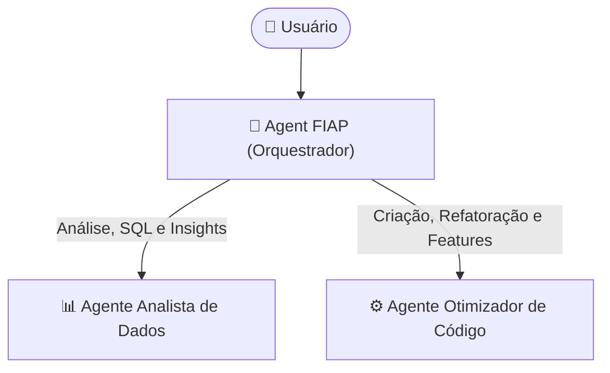

# 🤖 Agent FIAP

O **Agent FIAP** é um copiloto autônomo de **Análise de Dados e Engenharia de Pipelines**, inspirado na experiência do **Databricks Genie**.

Ele permite que cientistas, engenheiros e analistas interajam em linguagem natural para explorar bases de dados, responder perguntas de negócio com consultas SQL reais, investigar insights e criar, refatorar ou otimizar pipelines de dados e *Feature Engineering* diretamente no projeto — validando a execução do código de ponta a ponta.

---

## 🏗️ Arquitetura

O produto opera em uma arquitetura multi-agentes composta por **3 blocos principais**: um orquestrador central que interpreta a intenção do usuário e dois agentes especialistas que atuam sobre os dados e sobre o código.



- **Orquestrador (`agent_fiap`)**: Recebe o pedido em linguagem natural e direciona o fluxo para o especialista ideal.
- **Agente Analista (`agente_analista`)**: Explora os datasets da pasta `pipeline/dados/`, gera estatísticas descritivas, consulta regras de negócio via RAG e executa queries SQL analíticas.
- **Agente Otimizador (`agente_otimizador`)**: Lê, cria e otimiza pipelines em `pipeline/pipeline_prep.py`, desenvolve novas features para Machine Learning, salva as alterações no disco com backup automático e valida a execução real do script e dos testes.

---

## 🛠️ Tecnologias

- **Python**
- **Google ADK** (Orquestração Multi-Agentes e Interface Web)
- **LiteLLM** (Conector agnóstico de modelos: Ollama, Gemini, OpenAI, etc.)
- **ChromaDB** (RAG para documentação e regras de negócio)
- **Pandas, PySpark & Scikit-Learn** (Processamento de dados e *Feature Engineering*)
- **SQLite** (Motor analítico SQL em memória)

---

## 📋 Pré-requisitos

- **Git**
- **Python 3.13+** (via Conda, `venv` ou `uv`)
- **Provedor de LLM** (escolha um):
  - **Local**: [Ollama](https://ollama.com/) instalado e em execução.
  - **Nuvem**: Chave de API (ex: Google AI Studio / Gemini, OpenAI, Anthropic).

---

## 🚀 Como Executar

### 1. Prepare o Modelo (Caso use Ollama Local)
Se for utilizar um modelo local, inicie o servidor do Ollama e baixe o modelo desejado:
```bash
ollama serve
ollama pull qwen3.6:35b-a3b  # ou qwen2.5:14b
```

### 2. Configure o arquivo `.env`
Crie o seu arquivo `.env` a partir do exemplo do projeto:
```bash
cp .env.example .env
```

Edite o `.env` conforme o modelo que deseja utilizar:

- **Para usar Ollama (Local):**
  ```env
  LLM_MODEL=ollama_chat/qwen3.6:35b-a3b
  LLM_API_KEY=ollama
  LLM_API_BASE=http://localhost:11434
  ```

- **Para usar Google Gemini (Nuvem / Free Tier):**
  ```env
  LLM_MODEL=gemini/gemini-2.5-flash
  LLM_API_KEY=SUA_API_KEY_AQUI
  LLM_API_BASE=
  ```

### 3. Instale as dependências
Com **uv**:
```bash
uv sync --active
```

Ou com **pip**:
```bash
pip install -r requirements.txt
```

### 4. Inicie a Interface Web
Acesse a pasta `src` e suba o servidor do Google ADK:
```bash
cd src
adk web
```

Abra no navegador em **`http://localhost:8000`** e selecione **`agent_fiap`**.

---

## 🧪 Testes

Para rodar a suíte de testes automatizados:
```bash
pytest tests -v
```

---

## 👥 Autores

- **Matheus Santos** — `matheus.h.s.santos@hotmail.com`
- **Andre Yai** — `yai.andre@gmail.com`
- **Leo Takahara** — `takahara.leo@gmail.com`
- **Vinicius Alencar** — `viniciusalencaroliveira@gmail.com`
- **Hugo Martins** — `hmartins19@gmail.com`
- **Tiago Alvarenga** — `tiago.aalvarenga@gmail.com`
