# Arquitetura do Kraken Copilot

Este documento consolida a arquitetura da plataforma em dois níveis:
1. **[Visão Executiva (Pitch Deck)](#1-visão-executiva--pitch-de-apresentação-alto-nível)**: Diagrama direto e focado em proposta de valor, inteligência autônoma e ROI para apresentações executivas.
2. **[Arquitetura Técnica Detalhada](#2-arquitetura-técnica-detalhada-deep-dive)**: Visão completa dos componentes, fluxo de chamadas do Google ADK, 6 camadas de Guardrails e ciclo de vida no KrakenLake.

---

## 1. Visão Executiva / Pitch de Apresentação (Alto Nível)

```mermaid
flowchart LR
    %% Entrada
    subgraph IN ["1. ENTRADA SIMPLES"]
        User(["👤 Cientista de Dados\nou Líder Técnico"]):::pitchUser
        Input["Linguagem Natural\n+ Fontes de Dados (@)\n+ Comandos de Negócio (/)"]:::pitchCard
    end

    %% Plataforma Kraken Copilot
    subgraph ENGINE ["2. KRAKEN COPILOT ENGINE (Google Gemini + ADK)"]
        direction TB
        Orchestrator["🐙 Kraken Copilot (Orquestrador Central)\nRoteamento inteligente e compreensão de contexto"]:::pitchOrch

        subgraph SQUAD ["Especialistas Autônomos de Domínio"]
            direction LR
            A["📊 Data Analyst\nExploração estatística,\nqueries SQL e RAG"]:::pitchAnalyst
            B["⚙️ Feature Engineer\nCriação de features ML\nem Pandas e PySpark"]:::pitchCode
            C["🚀 Code Optimizer\nVetorização de loops e\nbenchmarks com evidências"]:::pitchOpt
        end

        Orchestrator --> SQUAD
    end

    %% Camada de Confiança e Governança
    subgraph TRUST ["3. GOVERNANÇA EMPRESARIAL"]
        Guardrails["🛡️ 6 Camadas de Guardrails\n• Imutabilidade do Data Lake (SHA-256)\n• Prevenção contra Data Leakage\n• Aprovação Humana Obrigatória (HITL)"]:::pitchGuard
    end

    %% Impacto / Valor de Negócio
    subgraph OUT ["4. IMPACTO DE NEGÓCIO (ROI)"]
        direction TB
        V1["⚡ 10x Mais Rápido\nDe dias para minutos na criação"]:::pitchVal
        V2["📈 Performance Comprovada\nRedução real de tempo e memória"]:::pitchVal
        V3["🔒 Zero Risco\nGovernança estrita e dados protegidos"]:::pitchVal
    end

    User --> Input
    Input --> Orchestrator
    SQUAD --> Guardrails
    Guardrails --> OUT

    %% Estilos Visuais
    classDef pitchUser fill:#3b82f6,stroke:#1d4ed8,stroke-width:2px,color:#ffffff;
    classDef pitchCard fill:#f8fafc,stroke:#cbd5e1,stroke-width:1px,color:#0f172a;
    classDef pitchOrch fill:#1e293b,stroke:#3b82f6,stroke-width:2px,color:#ffffff;
    classDef pitchAnalyst fill:#f3e8ff,stroke:#a855f7,stroke-width:2px,color:#581c87;
    classDef pitchCode fill:#ecfdf5,stroke:#10b981,stroke-width:2px,color:#064e3b;
    classDef pitchOpt fill:#fffbeb,stroke:#f59e0b,stroke-width:2px,color:#78350f;
    classDef pitchGuard fill:#fef2f2,stroke:#ef4444,stroke-width:2px,color:#991b1b;
    classDef pitchVal fill:#f0fdf4,stroke:#22c55e,stroke-width:2px,color:#14532d;
```

### Proposta de Valor do Pitch em 4 Pilares:
* **Entrada Sem Atrito**: O usuário não precisa saber comandos complexos; basta expressar a necessidade em linguagem natural ou arrastar dados para o chat.
* **Inteligência Especializada**: Três agentes focados que conhecem profundamente seus domínios (estatística, machine learning e engenharia de alta performance).
* **Segurança e Confiança Corporativa**: O assistente propõe com evidências matemáticas e benchmarks, mas a decisão final é sempre do especialista humano (Human-in-the-Loop).
* **ROI Tangível**: Eliminação de gargalos repetitivos de engenharia e garantia de pipelines sustentáveis e sem vazamento de dados.

---

## 2. Arquitetura Técnica Detalhada (Deep Dive)

Diagrama de arquitetura detalhado do Kraken Copilot, refletindo a orquestração multi-agente via **Google Agent Development Kit (ADK)**, os especialistas estritos, as 6 camadas de **Guardrails & Governança**, o **KrakenLake**, e a interface interativa com observabilidade.

```mermaid
flowchart TD
    %% Camada de Interface do Usuário
    subgraph UI ["🖥️ Camada de Interface & Experiência (Web UI)"]
        User(["👤 Usuário / Cientista de Dados"]):::userNode
        PromptBar["Prompt Bar Interativa\n(Atalhos @ Fontes, / Comandos, Seletor Gemini)"]:::uiNode
        ChatView["Chat Interativo & Observabilidade\n(Workflow Graph ReactFlow & Audit Panel)"]:::uiNode
        SideCode["Side Code Panel\n(Diffs com @pierre/diffs & Backups .bak)"]:::uiNode
        SideFiles["Sidebar Nav - Arquivos & Contexto\n(Drag & Drop de Datasets para o Chat)"]:::uiNode
    end

    User -->|"Solicitação ou Drag & Drop de Dados"| PromptBar
    SideFiles -.->|"Arrasta fontes para o chat"| PromptBar
    PromptBar --> ChatView

    %% Camada de Governança e Guardrails
    subgraph GuardrailsLayer ["🛡️ Guardrails & Governança (6 Camadas de Proteção)"]
        G_In["1. Anti-Injection & Sanitização de Entrada"]:::guardNode
        G_Lake["2. Imutabilidade do Data Lake (SHA-256)"]:::guardNode
        G_Circuit["3. Circuit Breaker Operacional Anti-Loop"]:::guardNode
        G_AST["4. Segurança Sintática & Contratos AST"]:::guardNode
        G_HITL["5. Governança Human-in-the-Loop (HITL)"]:::guardNode
        G_Out["6. Sanitização de Saída & Supressão de CoT"]:::guardNode
    end

    ChatView --> G_In

    %% Núcleo Multi-Agentes Google ADK
    subgraph ADK ["🐙 Kraken Copilot Multi-Agent Core (Google ADK + Gemini)"]
        Orchestrator["🐙 Kraken Copilot (root_agent)\nOrquestrador Principal: Roteamento & Síntese"]:::orchNode
        
        subgraph Specialists ["Subagentes Especialistas (Exatamente 3 Ferramentas Públicas Cada)"]
            Analyst["📊 Kraken Analyst\nAnálise Exploratória, SQL & RAG"]:::analystNode
            Code["⚙️ Kraken Code\nEngenharia de Features (Pandas & PySpark)"]:::codeNode
            Optimizer["🚀 Kraken Optimizer\nInspeção AST, Refatoração & Benchmarks"]:::optNode
        end
    end

    G_In --> Orchestrator
    Orchestrator -->|"Exploração, Estatísticas ou SQL"| Analyst
    Orchestrator -->|"Criação de Features / Pipelines do Zero"| Code
    Orchestrator -->|"Diagnóstico de Gargalos ou Otimização"| Optimizer

    %% Ferramentas Públicas dos Agentes
    subgraph AnalystTools ["Ferramentas do Analyst"]
        T_Analyze["analyze_dataset()\n(Estrutura, estatísticas, amostra)"]:::toolNode
        T_Query["query_dataset()\n(Consultas analíticas SQL SELECT)"]:::toolNode
        T_KB["search_knowledge_base()\n(Dicionário de dados & RAG)"]:::toolNode
    end
    Analyst --> T_Analyze & T_Query & T_KB

    subgraph CodeTools ["Ferramentas do Code"]
        T_GenFeat["generate_feature_pipeline()\n(Pipeline completo em Pandas/PySpark)"]:::toolNode
        T_AddFeat["add_feature_to_pipeline()\n(Injeção segura de features)"]:::toolNode
        T_PrevFeat["preview_features()\n(Prévia em amostra com nulos)"]:::toolNode
    end
    Code --> T_GenFeat & T_AddFeat & T_PrevFeat

    subgraph OptTools ["Ferramentas do Optimizer"]
        T_Inspect["inspect_pipeline()\n(Inspeção AST e detecção de issues)"]:::toolNode
        T_Opt["optimize_pipeline()\n(Vetorização, propostas e backups)"]:::toolNode
        T_Validate["validate_pipeline()\n(Testes e benchmark comparativo)"]:::toolNode
    end
    Optimizer --> T_Inspect & T_Opt & T_Validate

    %% Lakehouse KrakenLake & Persistência
    subgraph Lakehouse ["🗄️ KrakenLake & Persistência Local"]
        CatalogSources[("krakenlake/catalog/sources/\n(Datasets Brutos Imutáveis - CSV/Parquet)")]:::lakeNode
        CatalogMeta[("krakenlake/catalog/metadados/\n(Dicionários de Dados & Base RAG)")]:::lakeNode
        Workspace[("krakenlake/workspace/\n(Scripts Ativos: pipeline_prep, model_credito...)")]:::lakeNode
        TmpBackups[("krakenlake/tmp/\n(Snapshots Originais e Otimizados .bak)")]:::lakeNode
        SQLiteDB[("logs/kraken_copilot.db\n(Sessões, Execuções, Guardrails & Auditoria WAL)")]:::dbNode
    end

    T_Analyze & T_Query --> CatalogSources
    T_KB --> CatalogMeta
    T_GenFeat & T_AddFeat --> Workspace
    T_Inspect & T_Opt & T_Validate --> Workspace & TmpBackups
    T_Opt --> G_AST --> G_HITL

    %% Ciclo de Retorno e Aprovação Humana
    G_HITL -->|"Aprovação Explícita no Chat"| Workspace
    G_Out --> SideCode
    G_Out --> ChatView
    ChatView --> SQLiteDB

    %% Definição de Estilos
    classDef userNode fill:#e0e7ff,stroke:#6366f1,stroke-width:2px,color:#1e1b4b;
    classDef uiNode fill:#f8fafc,stroke:#cbd5e1,stroke-width:1px,color:#0f172a;
    classDef guardNode fill:#fef2f2,stroke:#ef4444,stroke-width:1px,color:#7f1d1d;
    classDef orchNode fill:#1e293b,stroke:#3b82f6,stroke-width:2px,color:#ffffff;
    classDef analystNode fill:#f3e8ff,stroke:#a855f7,stroke-width:2px,color:#581c87;
    classDef codeNode fill:#ecfdf5,stroke:#10b981,stroke-width:2px,color:#064e3b;
    classDef optNode fill:#fffbeb,stroke:#f59e0b,stroke-width:2px,color:#78350f;
    classDef toolNode fill:#f1f5f9,stroke:#94a3b8,stroke-width:1px,color:#334155;
    classDef lakeNode fill:#eff6ff,stroke:#3b82f6,stroke-width:1px,color:#1e3a8a;
    classDef dbNode fill:#f0fdf4,stroke:#22c55e,stroke-width:1px,color:#14532d;
```

---

## Principais Pilares da Arquitetura

### 1. Camada de Interface & Experiência (Web UI)
* **Prompt Bar com Contexto (@ e /)**: Composer rico com suporte a menção de dados (`@dados_vendas.csv`, `@dicionario_vendas.json`), comandos rápidos (`/features`, `/otimizar`, `/explorar`, `/sql`, `/criar`), alternador de modelos Gemini e ditado.
* **Sidebar com Drag & Drop**: Navegador lateral de arquivos do projeto que permite arrastar datasets e metadados diretamente para o chat como chips de contexto.
* **Side Code Panel com Diff**: Visualizador de código split em tempo real com `@pierre/diffs` para comparar a versão original com a proposta otimizada (`.bak`).
* **Observabilidade Interativa**: Grafo de workflow via `@xyflow/react` e matriz de auditoria de 6 camadas.

### 2. Orquestração Multi-Agente (Google ADK)
* **`kraken_copilot` (Orquestrador)**: Roteia intenções do usuário de forma ágil e consolida respostas executivas sem vazar logs internos.
* **`kraken_analyst` (Analista de Dados)**: Explora datasets, gera sumários estatísticos descritivos com IQR, roda consultas SQL SELECT e consulta a base de conhecimento RAG. Operações estritamente somente-leitura (sem travas de aprovação HITL).
* **`kraken_code` (Engenheiro de Features)**: Projeta e cria pipelines de ML em Pandas e PySpark, gera features derivadas (interações financeiras, RFM, transformações log e sazonais) e cria códigos do zero mesmo para arquivos vazios (`0 linhas`).
* **`kraken_optimizer` (Otimizador de Código)**: Inspeciona gargalos via AST, vetoriza loops, executa validações e gera tabela comparativa de benchmarks (Antes vs Depois) com speedup e redução de memória.

### 3. Matriz de Guardrails (6 Camadas)
1. **Segurança de Entrada & Anti-Injection**: Bloqueia prompt injection, jailbreaks e comandos destrutivos.
2. **Imutabilidade do Data Lake**: Validação criptográfica SHA-256 das fontes brutas em `krakenlake/catalog/sources/`.
3. **Circuit Breaker Operacional**: Limite estrito de transferências e escritas em disco para evitar loops infinitos.
4. **Segurança Sintática & Contratos AST**: Bloqueia `eval`, `exec`, `os.system` e valida preservação de contratos de entrada e saída.
5. **Governança Human-in-the-Loop (HITL)**: Gravação física no disco exige autorização explícita do usuário após apresentação da proposta e do diff (exclusivo para `kraken_code` e `kraken_optimizer`).
6. **Sanitização de Saída**: Supressão de chain-of-thought interno, tokens anômalos e vazamentos de credenciais.

### 4. Armazenamento Unificado
* **KrakenLake**: Estrutura organizada com `catalog/sources` (imutáveis), `catalog/metadados` (RAG e dicionários), `workspace` (scripts ativos do cientista) e `tmp` (backups versionados `.bak`).
* **SQLite com WAL (`logs/kraken_copilot.db`)**: Persistência ACID para sessões de chat, rastreamento de execuções com spans, métricas de benchmark e trilha de auditoria.

