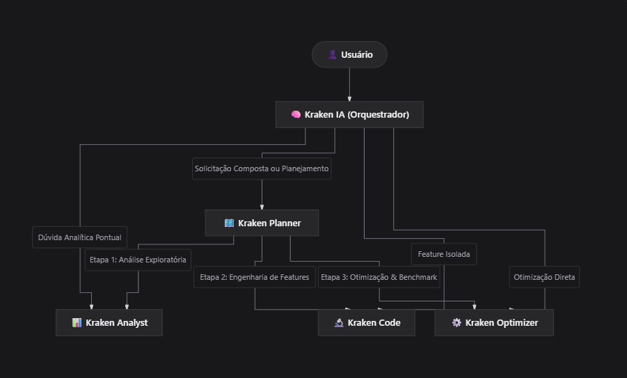
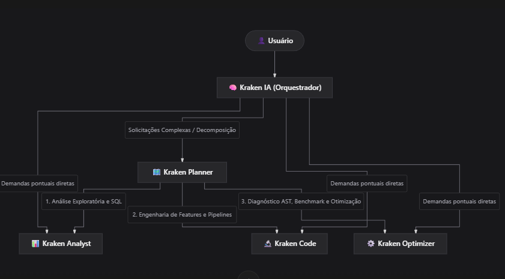

🐙 1. Nova Nomenclatura dos Agentes

| Identificador Técnico (`name`) | Nome de Exibição | Papel e Responsabilidades |
|---|---|---|
| **`kraken_copilot`** | **Kraken Copilot** | **Orquestrador Central:** Interpreta intenções gerais, direciona demandas complexas para o Planner e dúvidas pontuais diretamente para o especialista. |
| **`kraken_planner`** *(Novo)* | **Kraken Planner** | **Planejador Estratégico:** Decompõe solicitações complexas em etapas com dependências e critérios de sucesso, coordena execuções sequenciais e realiza replanejamento em imprevistos. |
| **`kraken_analyst`** | **Kraken Analyst** | **Especialista em Dados e SQL:** Análise exploratória, perfil estrutural, resumos estatísticos, consultas SQL em memória e Dicionário de Dados. |
| **`kraken_code`** | **Kraken Code** | **Especialista em Features e Pipelines:** Criação e enriquecimento de pipelines de ML em Pandas e PySpark, preview e prevenção de data leakage. |
| **`kraken_optimizer`** | **Kraken Optimizer** | **Especialista em Código e Benchmarks:** Diagnóstico AST, propostas com aprovação explícita, backups físicos (`.bak`) e benchmarks Antes vs. Depois. |

