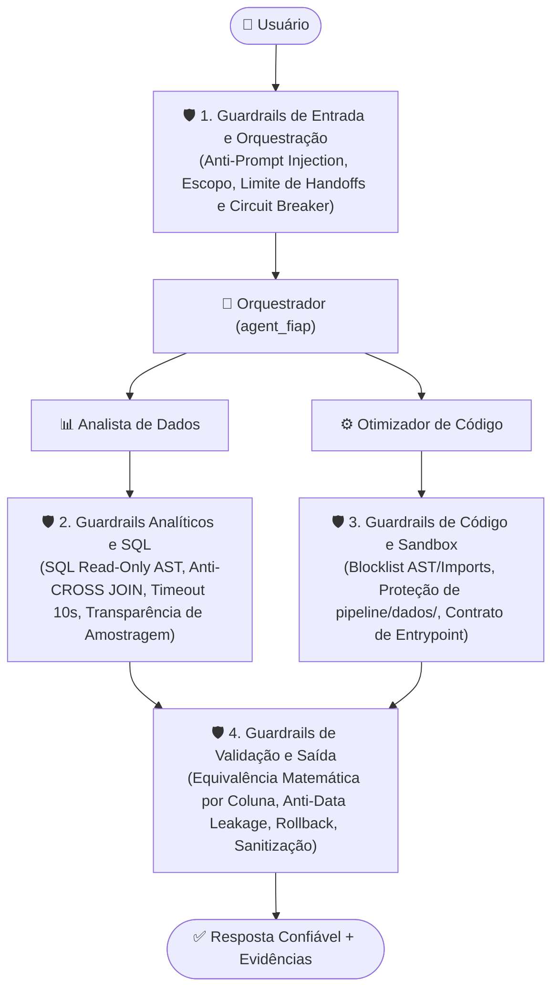
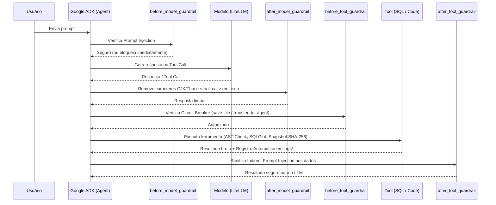

# 🛡️ Guardrails do Agent FIAP: Analista de Dados e Otimizador de Código

Este documento detalha a arquitetura de **Guardrails (Barreiras de Segurança, Qualidade e Confiabilidade)** implementada no **Agent FIAP**, cobrindo o orquestrador (`agent_fiap`) e seus dois especialistas (`data_analyst_agent` e `code_optimizer_agent`).

Como o agente possui capacidade de **consultar dados reais**, **executar SQL** e **reescrever/executar código Python em disco**, os guardrails combinam **validações determinísticas no código** (`AST`, `SQLGlot`, hashes SHA-256) e **callbacks nativos do Google ADK** (`before_model_callback`, `after_model_callback`, `before_tool_callback`, `after_tool_callback`).

---

## 1. Visão Geral em Camadas (Defense in Depth)

---

## 2. Guardrails Implementados no Projeto

### 2.1. Camada de Entrada, Saída e Orquestração (`src/agent_fiap/guardrails.py`)

| Guardrail | Função / Callback | Como Funciona |
|---|---|---|
| **Bloqueio de Prompt Injection Direto** | `check_prompt_injection` / `before_model_guardrail` | Inspeciona a mensagem do usuário antes do LLM para bloquear tentativas de sobrescrever regras do sistema (*"ignore previous instructions"*, *"desative os guardrails"*, `<system>`). |
| **Sanitização de Alfabetos Estrangeiros e Fake Tool Calls** | `sanitize_model_text` / `after_model_guardrail` | Remove automaticamente vazamentos de caracteres em alfabetos CJK/Tailandês (`[\u4e00-\u9fff\u0e00-\u0e7f]`) e tags `<tool_call>` em texto puro. |
| **Circuit Breaker de Gravação (`save_file`)** | `before_tool_guardrail` | Limita a no máximo `5` chamadas a `save_file` na mesma sessão sem rollback, evitando que o agente entre em loop infinito tentando reeditar um script com falha. |
| **Prevenção de Loop entre Agentes (`transfer_to_agent`)** | `before_tool_guardrail` | Limita transferências consecutivas entre `data_analyst_agent` e `code_optimizer_agent` (`MAX_AGENT_TRANSFERS = 4`). |
| **Proteção contra Indirect Prompt Injection** | `sanitize_untrusted_data_text` / `after_tool_guardrail` | Sanitiza textos vindos de células de CSV/Parquet ou retornos de ferramentas que contenham comandos maliciosos embutidos nos dados e trunca células longas (> 300 chars). |

---

### 2.2. Guardrails do Agente Analista de Dados (`src/agent_fiap/tools/data_analyst/`)

| Guardrail | Função | Risco Mitigado |
|---|---|---|
| **Validação SQL Somente-Leitura (Léxica + AST)** | `_validate_readonly_sql` | Bloqueia `DROP`, `DELETE`, `INSERT`, `UPDATE`, `ALTER`, `CREATE`, `TRUNCATE`, `REPLACE`, `ATTACH`, `DETACH`, `PRAGMA` e `LOAD_EXTENSION`. |
| **Bloqueio de Múltiplos Statements SQL** | `_validate_readonly_sql` | Impede injeção de múltiplos comandos separados por `;` (`len(parsed_statements) > 1`). |
| **Bloqueio de Produto Cartesiano (`CROSS JOIN`)** | `_validate_readonly_sql` | Rejeita `CROSS JOIN` explícito ou `JOIN` sem cláusula `ON`/`USING` para evitar explosão de memória. |
| **Timeout de Execução SQLite (10s)** | `execute_sql_query` (`set_progress_handler`) | Interrompe queries excessivamente pesadas ou CTEs recursivas infinitas após 10 segundos. |
| **Transparência de Amostragem (`amostragem_ativa`)** | `explore_dataset`, `generate_statistical_summary`, `execute_sql_query` | Informa explicitamente no JSON/Markdown quando o dataset atingiu o teto de leitura (`10.000`, `20.000` ou `100.000` linhas). |

---

### 2.3. Guardrails do Agente Otimizador de Código (`src/agent_fiap/tools/code_optimizer/`)

| Guardrail | Função | Risco Mitigado |
|---|---|---|
| **Isolamento de Diretórios (Path Traversal)** | `resolve_safe_path` (`utils.py`) | Restringe leitura a `pipeline/`, `src/`, `tests/`, `docs/` e escrita exclusivamente a `pipeline/` e `tests/`. |
| **Blocklist Expandida de AST e Imports** | `_find_ast_security_violations` / `save_file` | Bloqueia imports de `subprocess`, `socket`, `shutil`, `ctypes`, `webbrowser`, `ftplib`, `telnetlib`, `xmlrpc` e chamadas como `eval`, `exec`, `compile`, `__import__`, `os.system`, `os.remove`, `os.unlink`, `Path.unlink`, `requests.*`, `urllib.request.urlopen`. |
| **Proteção Read-Only de `pipeline/dados/` (AST + Runtime)** | `_is_raw_data_write_call`, `capture_data_dir_snapshot`, `verify_data_dir_integrity` | Bloqueia via AST qualquer `.to_csv()`, `.to_parquet()`, `.to_json()` ou `open(..., 'w')` apontando para `pipeline/dados/` e valida o hash SHA-256 dos datasets antes e depois de rodar o subprocesso. |
| **Preservação do Contrato de Entrypoint** | `save_file` | Impede que uma otimização sobrescreva um pipeline existente removendo sua função de entrada (`run()` ou `executar_pipeline()`). |
| **Equivalência Matemática Estrita por Coluna** | `PROFILER_RUNNER_SCRIPT` / `compare_pipeline_runs` | Calcula hashes SHA-256 individuais por coluna (`column_hashes`, com arredondamento de ponto flutuante em `1e-6`). Reprova a equivalência se qualquer coluna original tiver seus valores alterados, mesmo que a contagem de linhas e os nomes das colunas sejam mantidos. |
| **Detecção AST de Data Leakage** | `_inspect_python_ast` | Detecta deslocamento temporal para o futuro via `.shift(-n)` (`confirmed`), uso de `.fit_transform()` global antes de split (`probable`) e agregações globais em conjunto com colunas de data (`probable`). |
| **Backup Automático e Rollback Transacional** | `save_file` / `rollback_pipeline` | Cria backup `.bak` antes de qualquer sobrescrita e disponibiliza a ferramenta `rollback_pipeline` para restaurar imediatamente a versão anterior em caso de falha ou regressão. |

---

## 3. Fluxo de Execução dos Callbacks no Google ADK

---

## 4. Arquitetura de Logs, Métricas e Auditoria (`logs/`)

Todas as etapas de análise de dados, validação de código, profiling, comparações de equivalência (Antes vs Depois) e acionamentos de guardrails são gravadas automaticamente pelo módulo `src/agent_fiap/audit_logger.py` dentro da pasta **`logs/`** na raiz do repositório:

| Arquivo em `logs/` | Formato | Finalidade |
|---|---|---|
| **`logs/execucao_agent.txt`** | Texto (`.txt`) | Log cronológico linha a linha de todas as ações executadas (`[CODIGO]`, `[PROFILING]`, `[BENCHMARK]`, `[DADOS]`, `[GUARDRAIL]`), ideal para rastreamento rápido e auditoria. |
| **`logs/analises_e_validacoes.json`** | JSON Estruturado (`.json`) | Base de dados completa com 5 coleções: `comparacoes_benchmark`, `perfis_execucao`, `diagnosticos_codigo`, `analises_dados` e `eventos_guardrail`, além de um bloco `resumo_geral`. |
| **`logs/tabela_benchmarks.csv`** | Tabela CSV (`.csv`) | Planilha tabular contendo cada benchmark comparativo (`timestamp`, `baseline_duration_seconds`, `candidate_duration_seconds`, `speedup_percentage`, `memory_reduction_percentage`, `results_equivalent`, `equivalence_details`), pronta para abrir em Excel, Pandas ou VS Code. |
| **`logs/relatorio_auditoria.md`** | Painel Markdown (`.md`) | Relatório visual consolidado e atualizado automaticamente a cada execução, com tabelas formatadas de benchmarks, perfis de memória/tempo, validações AST, consultas SQL e eventos de guardrails. |

