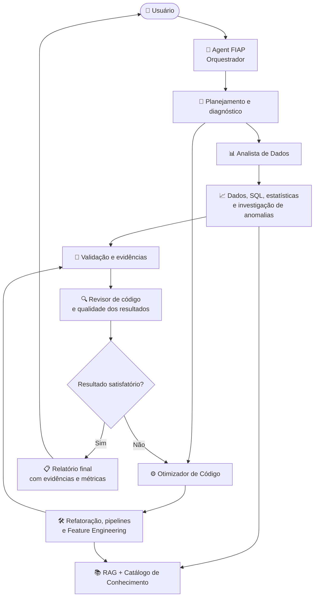
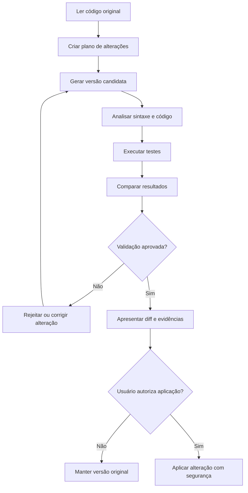
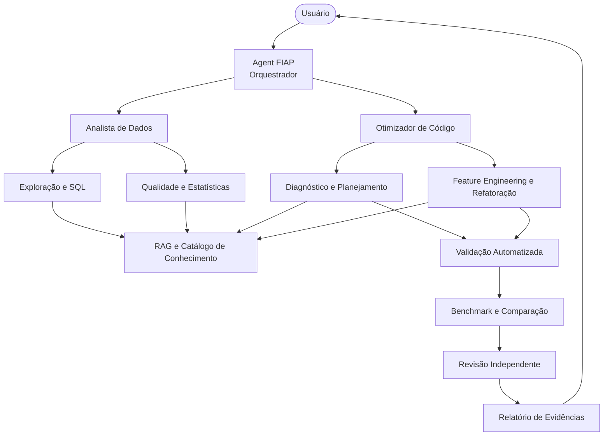

import pypandoc

markdown_content = r"""# Evolução do Agent FIAP: Analista de Dados e Otimizador de Código

## Visão geral

O projeto já tem uma boa base: um orquestrador com dois especialistas, ferramentas para explorar datasets, executar SQL, consultar uma base RAG, editar arquivos Python, executar pipelines e rodar testes.

**A recomendação é evoluir o Agent FIAP de um agente que analisa dados e modifica código para um agente que entende o problema, investiga a causa, propõe uma solução, implementa a mudança e comprova se ela realmente melhorou alguma coisa.**

O maior salto de qualidade não virá necessariamente de adicionar mais agentes. Virá de melhorar o processo de decisão, as ferramentas disponíveis e a validação dos resultados.

# 1. Arquitetura proposta

Eu manteria os dois agentes especialistas e adicionaria novas capacidades gradualmente, sem transformar o projeto em uma arquitetura excessivamente complexa.



O fluxo é conceitual: algumas capacidades podem ser ferramentas ou etapas do processo, sem precisar virar novos agentes do Google ADK.

## As seis melhorias de maior valor

| Prioridade | Melhoria | O que acrescenta ao projeto |
|---|---|---|
| 1 | Diagnóstico automático de código | Identifica problemas antes de começar a editar |
| 2 | Benchmark antes e depois | Comprova se a otimização trouxe ganhos reais |
| 3 | Validação automatizada de dados | Detecta erros de qualidade e mudanças inesperadas |
| 4 | Planejamento e execução em etapas | Evita alterações grandes sem diagnóstico prévio |
| 5 | Catálogo de features com busca semântica | Sugere features existentes antes de criar outras |
| 6 | Revisor independente de código | Encontra regressões, problemas de lógica e riscos |

# 2. Diagnóstico automático de código

Hoje, o `code_optimizer_agent` recebe a solicitação, lê o arquivo e pode começar a modificá-lo. Eu mudaria essa abordagem para um fluxo de **diagnóstico → plano de ação → implementação → validação**.

Imagine que o usuário peça:

> Otimize meu pipeline de preparação de dados e melhore a criação das features.

Em vez de reescrever o código imediatamente, o agente deveria investigar:

1. Quais arquivos compõem o pipeline?
2. Quais datasets são utilizados?
3. Quais transformações são realizadas?
4. Existem operações redundantes?
5. Há conversões de tipos desnecessárias?
6. Existem loops que poderiam ser substituídos por operações vetorizadas?
7. Há risco de vazamento de dados?
8. Alguma transformação altera a semântica das features?
9. Quais testes podem comprovar que o resultado foi preservado?

## Nova ferramenta: `analyze_code`

Criaria uma ferramenta que recebe o caminho do arquivo e retorna um diagnóstico estruturado.

Exemplo de retorno:

```json
{
  "file": "pipeline/pipeline_prep.py",
  "issues": [
    {
      "category": "performance",
      "severity": "medium",
      "location": "transform_features",
      "description": "Conversão repetida de tipos dentro de uma sequência de transformações",
      "recommendation": "Avaliar a possibilidade de realizar a conversão uma única vez",
      "confidence": 0.91
    },
    {
      "category": "correctness",
      "severity": "high",
      "location": "create_features",
      "description": "Possível vazamento de informação entre treino e validação",
      "recommendation": "Verificar a ordem de separação dos dados e ajuste dos transformadores",
      "confidence": 0.78
    }
  ]
}
```

Os resultados são ilustrativos, não um diagnóstico do pipeline real.

**Como implementar:** combine análise estática com ferramentas como `ast`, `ruff` e `radon`, além da análise semântica realizada pelo LLM. Para encontrar problemas que dependem dos dados ou do comportamento de execução, acrescente testes e profiling.

A análise estática não consegue provar, sozinha, que existe vazamento de dados ou que determinada operação é lenta.

O importante é separar três categorias:

- **Problemas confirmados:** comprovados por regras, testes ou evidências.
- **Problemas prováveis:** hipóteses que precisam ser investigadas.
- **Oportunidades de melhoria:** sugestões que dependem do contexto.

Isso reduz o risco de o modelo apresentar suposições como se fossem defeitos comprovados.

# 3. Benchmark real antes e depois da otimização

Esta seria uma das funcionalidades mais importantes do projeto.

Atualmente, `run_pipeline()` e `run_tests()` ajudam a verificar se o código executa e se os testes passam, mas não demonstram necessariamente que uma otimização melhorou o desempenho.

Exemplo hipotético:

| Métrica | Antes | Depois |
|---|---:|---:|
| Tempo de execução | 42 s | 19 s |
| Pico de memória | 850 MB | 510 MB |
| Testes aprovados | 15/15 | 15/15 |
| Equivalência dos resultados | — | Aprovada |

Nesse exemplo, o pipeline ficou aproximadamente 55% mais rápido e reduziu o pico de memória em 40%, mantendo os testes aprovados.

## Ferramentas propostas

### `profile_pipeline()`

Responsável por medir o comportamento do código. Poderia retornar:

- Tempo total de execução.
- Pico de memória do processo.
- Tempo por etapa, quando instrumentado.
- Quantidade de linhas processadas.
- Métricas de operações específicas, se disponíveis.
- Erros e avisos encontrados.

### `compare_pipeline_runs()`

Compara os resultados da versão original com os da versão modificada.

O agente não poderia declarar que otimizou o pipeline apenas porque o código parece mais limpo. Ele precisaria apresentar as métricas coletadas.

**Cuidado:** as comparações precisam utilizar dados e condições equivalentes. Execuções isoladas podem sofrer influência de cache, aquecimento, carga do sistema e variação de recursos.

Eu implementaria esse recurso com:

- `time.perf_counter()` para medir duração.
- `tracemalloc` para investigar alocações rastreadas pelo Python.
- `psutil` para acompanhar memória do processo.
- Profilers específicos para operações mais complexas, quando necessário.

Para PySpark, seria necessário medir também o comportamento distribuído, considerando jobs, stages, shuffle, spill e execução no cluster. Medir somente o processo Python local não seria suficiente.

## Modos de otimização

O usuário poderia escolher entre três modos:

- **Conservador:** mudanças pequenas, priorizando a preservação do comportamento.
- **Performance:** prioriza redução de tempo e consumo de recursos.
- **Qualidade:** prioriza legibilidade, modularidade, tipagem e manutenção.

O modo escolhido altera o plano de execução, não elimina a obrigação de testar as mudanças.

# 4. Validação de qualidade dos dados

O agente analítico já consegue explorar datasets, gerar estatísticas e executar SQL. Entretanto, existe uma diferença importante entre analisar os dados e verificar automaticamente se eles estão adequados para alimentar um modelo.

Eu adicionaria um módulo de **Data Quality**.

## Nova ferramenta: `validate_dataset`

Ela receberia um dataset e um conjunto opcional de regras de validação.

Exemplo:

```python
rules = {
    "required_columns": [
        "cpf",
        "data_referencia",
        "renda",
    ],
    "not_null": [
        "cpf",
        "data_referencia",
    ],
    "unique": [
        "cpf",
        "data_referencia",
    ],
    "ranges": {
        "renda": {
            "min": 0,
            "max": 1_000_000,
        }
    },
}
```

Os limites são ilustrativos e deveriam ser definidos conforme as regras de negócio.

Exemplo de retorno:

```json
{
  "dataset": "clientes",
  "status": "warning",
  "checks": {
    "required_columns": "passed",
    "not_null": "passed",
    "unique": "failed",
    "ranges": "passed"
  },
  "issues": [
    {
      "rule": "unique",
      "columns": ["cpf", "data_referencia"],
      "duplicate_rows": 124
    }
  ]
}
```

## O que isso permitiria?

O agente poderia investigar problemas antes de criar novas features.

Por exemplo, se o usuário pedisse uma feature com a média de compras dos últimos 90 dias, o agente poderia verificar:

1. Se existe uma coluna de data confiável.
2. Se há uma chave de identificação do cliente.
3. Se existem registros duplicados.
4. Se há dados ausentes nas variáveis relevantes.
5. Se a janela de 90 dias deve ser móvel ou baseada em datas de referência.
6. Se a feature pode utilizar informações que não estavam disponíveis no momento da previsão.

O último item é especialmente importante: uma feature pode ser calculada sem erros e ainda assim estar incorreta para o objetivo do modelo.

## Evolução posterior

Você poderia adicionar regras de monitoramento de dados, como:

- Mudanças no esquema.
- Aumento da taxa de valores nulos.
- Alterações na distribuição das variáveis.
- Valores fora de faixas esperadas.
- Mudanças na cardinalidade.
- Duplicidades inesperadas.
- Diferenças entre dados de treinamento e produção.

Para o projeto atual, começaria com validações determinísticas e relatórios. Monitoramento contínuo pode ficar para uma etapa posterior.

# 5. Planejamento de execução e alterações seguras

Existe um ponto no código atual que eu mudaria antes de adicionar muitas outras funcionalidades.

Seu `save_file()` cria um backup, mas grava o novo conteúdo diretamente no arquivo original. Depois, `run_pipeline()` executa o script e `run_tests()` roda a suíte de testes.

Isso significa que, se a execução falhar, o código problemático já poderá ter substituído o original.

Eu implementaria um fluxo transacional de alterações.



## Ferramentas propostas

| Ferramenta | Responsabilidade |
|---|---|
| `create_change_plan` | Registrar as alterações pretendidas e seus motivos |
| `apply_patch` | Aplicar alterações localizadas, em vez de reescrever arquivos inteiros sempre que possível |
| `get_file_diff` | Exibir exatamente o que mudou |
| `validate_candidate` | Validar a versão candidata antes de substituir a original |
| `rollback_changes` | Restaurar a versão anterior em caso de falha |

Eu também adicionaria um identificador para cada alteração, permitindo relacionar o diagnóstico, o diff, os testes e as métricas da execução.

**Regra fundamental:** o agente deve distinguir entre preparar uma alteração e aplicá-la definitivamente. Para mudanças destrutivas ou de grande impacto, exija autorização explícita.

Um backup é útil, mas não substitui testes em uma versão isolada. Também é importante executar o código em um ambiente controlado, com limites de tempo, memória e acesso ao sistema.

# 6. Catálogo inteligente de features

Esta funcionalidade tem potencial para diferenciar o projeto de um assistente genérico de programação.

Em vez de simplesmente pedir ao LLM que invente features, o agente poderia pesquisar o conhecimento já existente e identificar variáveis reutilizáveis.

## Exemplo de utilização

**Usuário:**

> Quero criar features de comportamento de compra para um modelo de propensão à conversão.

O fluxo seria:

1. Identificar o objetivo da feature.
2. Explorar os datasets disponíveis.
3. Consultar a base de conhecimento.
4. Pesquisar features existentes por significado.
5. Comparar definições, granularidade e janelas temporais.
6. Identificar possíveis duplicidades.
7. Propor novas features apenas quando necessário.
8. Implementar e testar as transformações aprovadas.

## Nova ferramenta: `search_feature_catalog`

Eu faria essa ferramenta consultar um catálogo estruturado, inicialmente em arquivos locais ou em um banco simples.

Cada feature poderia conter:

| Campo | Finalidade |
|---|---|
| `feature_name` | Nome técnico |
| `description` | Definição funcional |
| `entity` | Entidade de referência |
| `source` | Origem dos dados |
| `business_domain` | Domínio de negócio |
| `calculation` | Regra de cálculo |
| `window` | Janela temporal |
| `data_type` | Tipo de saída |
| `owner` | Responsável |
| `status` | Situação da feature |
| `tests` | Regras de validação |
| `availability_time` | Momento em que os dados ficam disponíveis |

A estrutura é uma proposta de evolução, não algo que precise ser implementado inteiro agora.

## Por que incluir busca semântica?

Considere duas features:

- `media_compras_90d`
- `valor_medio_pedido_ultimos_3_meses`

Os nomes são diferentes, mas as definições podem representar a mesma informação.

Uma busca lexical pode não reconhecer essa relação. A busca semântica ajuda a encontrar candidatos equivalentes.

Entretanto, **similaridade semântica não comprova equivalência matemática**. O agente também deve comparar entidade, granularidade, janela, filtros e regra de cálculo.

O projeto já possui ChromaDB para consultar documentação. Essa infraestrutura pode servir como ponto de partida, mas eu separaria os documentos de regras de negócio dos registros estruturados de features.

O agente deveria retornar:

- Features existentes que podem ser reutilizadas.
- Features semelhantes que precisam de análise.
- Features novas recomendadas.
- Dados e regras necessários para implementá-las.

Isso reduz duplicidade e incentiva o reaproveitamento de conhecimento.

# 7. Revisor independente de código

Hoje, o mesmo agente que modifica o código também é responsável por avaliar a própria implementação.

Isso pode funcionar, mas existe um risco: o modelo pode defender a solução que acabou de produzir e deixar passar problemas.

Eu acrescentaria uma etapa de revisão independente. Ela pode começar como uma ferramenta de revisão e, se houver necessidade, evoluir para um terceiro subagente.

## O que o revisor avaliaria?

### Corretude

- O comportamento original foi preservado?
- Há erros de lógica ou tratamento inadequado de nulos?
- Os tipos de dados estão corretos?

### Performance

- Existem operações redundantes?
- A otimização proposta é sustentada por evidências?
- Há consumo desnecessário de memória?

### Machine Learning

- Existe risco de data leakage?
- A transformação é compatível com treino e inferência?
- Há risco de inconsistência entre as etapas?
- A feature respeita a disponibilidade temporal dos dados?

### Manutenção

- O código está organizado?
- Há funções excessivamente grandes?
- Existem duplicações?
- Os nomes são claros?

### Testes

- Os cenários críticos foram cobertos?
- Existem testes para valores nulos, duplicidades e casos extremos?
- Os resultados anteriores e posteriores são equivalentes quando deveriam ser?

## Ferramentas complementares

Eu integraria verificações determinísticas com:

- `ruff` para lint e problemas comuns de código.
- `mypy` ou `pyright` para análise de tipos, quando fizer sentido.
- `pytest` para testes automatizados.
- `coverage.py` para medir cobertura de testes.
- Ferramentas de profiling para investigar performance.

O LLM seria responsável por interpretar os achados, avaliar o contexto e sugerir correções. As ferramentas determinísticas forneceriam evidências que o modelo não deveria inventar.

# 8. Evolução do RAG atual

O código de RAG já possui uma estrutura inicial útil: indexa arquivos `.md`, `.txt` e `.sql` e permite recuperar documentos pelo significado da consulta.

Entretanto, eu melhoraria quatro pontos.

## 8.1. Divisão dos documentos em chunks

Hoje, você armazena cada documento inteiro e limita o trecho retornado a mil caracteres.

Isso pode ser insuficiente para documentos longos, porque uma regra importante pode estar distante do início do arquivo.

Eu dividiria os documentos em trechos menores, preservando o contexto e os metadados necessários.

## 8.2. Atualização do índice

Seu código utiliza um identificador baseado no caminho do arquivo. Se um documento mudar de conteúdo, o mesmo identificador será utilizado no `upsert`.

Isso permite atualizar o registro, mas não resolve sozinho a detecção de arquivos removidos. Além disso, o índice só é construído automaticamente quando a coleção está vazia.

Eu adicionaria:

- Hash do conteúdo.
- Identificação de documentos alterados.
- Atualização incremental.
- Remoção de documentos excluídos da origem.
- Registro da data da última indexação.

## 8.3. Recuperação mais precisa

Em vez de recuperar apenas três documentos, eu implementaria uma estratégia configurável de recuperação, com:

- Busca semântica.
- Filtros por tipo de documento ou domínio.
- Reordenação dos candidatos, quando necessária.
- Identificação das fontes utilizadas.

Não aumentaria simplesmente o número de resultados: recuperaria mais candidatos e selecionaria os mais relevantes para a pergunta.

## 8.4. Respostas fundamentadas nas fontes

O agente deveria distinguir explicitamente:

- O que está documentado.
- O que foi inferido pelo modelo.
- O que foi confirmado por ferramentas.
- O que ainda precisa ser validado.

Isso é especialmente útil quando o RAG contém regras de negócio, definições de métricas e convenções de features.

# 9. Outras melhorias para etapas futuras

As seis melhorias anteriores já formam uma evolução considerável. Depois de implementá-las, eu avaliaria estas funcionalidades.

| Funcionalidade | Como funcionaria | Prioridade |
|---|---|---|
| Gerador de testes | Criaria testes para funções e transformações existentes | Alta |
| Explicação de código | Explicaria o funcionamento de um pipeline por etapas | Alta |
| Geração de documentação | Geraria docstrings, contratos e documentação técnica | Média |
| Detecção de anomalias | Investigaria valores inesperados e mudanças estatísticas | Média |
| Sugestão de SQL | Geraria consultas com base no esquema real dos datasets | Média |
| Memória de projetos | Recuperaria decisões técnicas e preferências do projeto | Média |
| Histórico de alterações | Registraria mudanças, motivos, testes e resultados | Alta |
| Detecção de regressões | Compararia resultados entre versões do pipeline | Alta |
| Geração de diagramas | Representaria dependências e transformações do pipeline | Média |
| Explicação de erros | Interpretaria tracebacks e sugeriria correções fundamentadas | Alta |

Uma funcionalidade que merece atenção especial é a **análise de impacto**.

Se o agente modificar uma função que cria cinco features utilizadas por outras etapas, ele deveria identificar quais componentes podem ser afetados antes de aplicar a alteração.

Isso exige conhecer as dependências do código. Você pode começar com uma análise estática dos imports e chamadas de funções e evoluir para um grafo de dependências do pipeline.

# 10. Melhorias no orquestrador

O `AGENT_FIAP_INSTRUCTION` atualmente orienta o modelo a transferir imediatamente a solicitação para um especialista.

Essa regra é simples, mas pode ser melhorada.

Por exemplo, imagine que o usuário diga:

> O pipeline está lento. Descubra o problema e corrija.

A solicitação envolve duas tarefas diferentes:

1. Investigar o comportamento do pipeline.
2. Implementar e validar uma correção.

O orquestrador deveria coordenar as duas etapas, em vez de tratar a solicitação como uma simples operação de edição.

## Estratégia de roteamento

| Situação | Estratégia |
|---|---|
| Pergunta sobre dados | Encaminhar para o analista |
| Pedido de alteração de código | Encaminhar para o otimizador |
| Investigação de lentidão | Diagnosticar antes de modificar |
| Criação de features | Investigar os dados, consultar o catálogo e implementar |
| Erro de execução | Analisar o traceback, reproduzir o erro e propor uma correção |
| Otimização com requisitos ambíguos | Fazer perguntas antes de alterar o comportamento |
| Análise seguida de implementação | Coordenar os especialistas em sequência |

## Não delegar tudo ao LLM

Nem toda decisão precisa ser tomada por um modelo de linguagem.

Você pode utilizar regras determinísticas para decidir quando executar testes, coletar métricas ou exigir aprovação.

Por exemplo:

- Se houver alteração em arquivo Python, executar a análise sintática.
- Se houver alteração em uma transformação de dados, executar testes pertinentes.
- Se a tarefa for otimização, medir o desempenho antes e depois, quando possível.
- Se os testes falharem, não declarar a alteração validada.
- Se houver alteração destrutiva, exigir autorização.

O LLM ficaria responsável pelo raciocínio contextual, enquanto o código convencional garantiria que os procedimentos obrigatórios fossem cumpridos.

Isso também reduz o número de chamadas desnecessárias ao modelo.

# 11. Plano de implementação em três fases

Eu não implementaria tudo de uma vez. O projeto já possui várias ferramentas, então o próximo passo deveria ser aumentar a confiabilidade delas.

## Fase 1 — Tornar o agente confiável

**Objetivo: garantir que ele faça mudanças corretas e consiga demonstrar o resultado.**

Implementaria:

1. Diagnóstico automático de código.
2. Diff das alterações.
3. Execução de testes antes e depois.
4. Benchmark de performance.
5. Validação de equivalência dos resultados.
6. Proteção para não sobrescrever código original sem validação.
7. Relatório final estruturado.

Ao terminar essa fase, o agente deverá conseguir explicar o que identificou, o que mudou, quais testes executou e quais melhorias foram comprovadas.

## Fase 2 — Tornar o agente mais inteligente

**Objetivo: fazer com que ele compreenda melhor os dados e o contexto do projeto.**

Implementaria:

1. Validação de qualidade dos dados.
2. Geração automática de testes.
3. Análise de dependências entre funções.
4. Catálogo de features.
5. Recuperação de conhecimento aprimorada.
6. Detecção de possíveis problemas de Machine Learning.
7. Sugestões de otimização baseadas em evidências.

Ao terminar essa fase, o agente deverá ser capaz de identificar problemas que não são evidentes apenas pela leitura do código.

## Fase 3 — Tornar o agente um ambiente de engenharia de dados

**Objetivo: transformar o projeto em uma ferramenta mais completa para desenvolver e manter pipelines.**

Implementaria:

1. Histórico de alterações e resultados.
2. Comparação entre versões.
3. Relatórios de qualidade e performance.
4. Grafo de dependências do pipeline.
5. Geração de documentação.
6. Catálogo de conhecimento sobre o projeto.
7. Interface própria para acompanhar análises, alterações e validações.

Essa fase depende de quanto você deseja aproximar o projeto de uma plataforma de desenvolvimento de dados, em vez de mantê-lo como um assistente local.

# 12. Arquitetura final desejada

Eu manteria os dois agentes que você já criou, adicionando capacidades especializadas sem necessariamente criar um agente para cada função.



Essa arquitetura é conceitual. O Google ADK pode orquestrar os agentes, enquanto ferramentas Python executam operações determinísticas.

# Recomendação final

Se eu estivesse desenvolvendo esse projeto, **a primeira funcionalidade que implementaria seria um ciclo de otimização com evidências**.

O fluxo seria:

1. Ler e entender o código original.
2. Investigar os dados e as dependências relevantes.
3. Identificar problemas e oportunidades de melhoria.
4. Apresentar um plano de alterações.
5. Criar uma versão candidata do código.
6. Executar testes e verificar a equivalência dos resultados.
7. Comparar performance e consumo de memória.
8. Revisar o diff e os resultados.
9. Aplicar as alterações aprovadas.
10. Gerar um relatório final.

O diferencial não seria simplesmente o agente escrever código melhor. Seria ele conseguir **demonstrar por que uma mudança é necessária, quais riscos existem e se a solução realmente melhorou o pipeline**.

Depois disso, eu partiria para o catálogo inteligente de features e a validação de qualidade dos dados.

Essas duas funcionalidades aproximariam o projeto de um assistente especializado em Ciência de Dados e Engenharia de Features, em vez de apenas um agente genérico que escreve Python.

**Uma última observação:** antes de aumentar a quantidade de agentes, eu investiria na qualidade das ferramentas e dos contratos de entrada e saída. Um agente que recebe dados corretos, executa ferramentas confiáveis e verifica seus resultados costuma ser mais útil do que vários agentes especializados trabalhando sobre informações incompletas.
"""

output_path = "/mnt/data/evolucao_kraken_copilot.md"
pypandoc.convert_text(
    markdown_content,
    "md",
    format="md",
    outputfile=output_path,
    extra_args=["--standalone"],
)
print(f"Arquivo Markdown criado: {output_path}")
